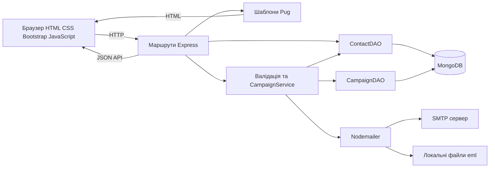

# Пояснення реалізації вправи Пособник спамера

Застосунок «Листоноша» реалізує адресну книгу та надсилання повідомлень через вебінтерфейс. Контакти зберігаються у MongoDB. Початковий HTML формує Express із шаблонів Pug, а подальший обмін із браузером здійснюється через JSON API. Для перевірки без поштових реквізитів передбачено створення локальних MIME-листів. Звичайний режим підтримує SMTP.

## Відповідність умовам

| Умова вправи | Реалізація |
| --- | --- |
| База електронних адрес із ПІБ | Колекція `contacts`: `lastName`, `firstName`, `middleName`, `email` |
| Зберігання у MongoDB або MySQL | MongoDB, офіційний драйвер `mongodb` |
| Node.js та Express на сервері | `src/server.js`, `src/app.js` |
| Відсортований перелік | MongoDB collation `uk`; у браузері також `Intl.Collator('uk')` |
| Вибір із готових повідомлень | Три шаблони в `src/data/templates.js` |
| Введення власного тексту | Поля теми й тексту на сторінці нової розсилки |
| Надсилання листів за адресами | `CampaignService` і `createMailer`, SMTP через Nodemailer |
| Додавання, редагування, вилучення | Вікна Bootstrap та API POST, PUT, DELETE |
| Відображення через Twitter Bootstrap | Локальні Bootstrap CSS, JS, сітка, форми, таблиці, modal, toast |
| Додаткова вимога викладача: Twig, Pug або MJML | Pug: успадкування layout, include, цикли меню, таблиці контактів і карток шаблонів; окремий HTML-шаблон листа |

## Архітектура



Рівень представлення розміщений у `views` та `public`. Шаблони Pug формують початкову сторінку, меню, картки повідомлень і перші рядки контактів із MongoDB. `views/index.pug` успадковує `layout.pug`, а спільні частини підключаються через `include`. Цикли `each` використовуються для меню, контактів і шаблонів листів. Pug екранує значення, які виводяться через `=`. Клієнтський JavaScript відображає подальші оновлення, збирає значення полів і виконує `fetch`. Персональні дані не зберігаються в `localStorage` чи в масиві замість бази.

Прикладний рівень у `src/services` формує розсилку, обирає адресатів, перевіряє ліміт і збирає результати. Вхідні дані додатково перевіряються сервером. Усі звернення прикладного коду до контактів і розсилок проходять через DAO.

Рівень даних у `src/dao` працює з MongoDB. `src/db.js` створює підключення та індекси. Доступ до колекцій відокремлений від HTML і від логіки надсилання. Це невеликий моноліт із трьома логічними рівнями, відповідно до матеріалів про архітектуру моноліту.

## Колекції MongoDB

Приклад документа `contacts`:

```javascript
{
  _id: ObjectId("…"),
  lastName: "Коваленко",
  firstName: "Олександр",
  middleName: "Петрович",
  email: "oleksandr.kovalenko@example.com",
  createdAt: ISODate("…"),
  updatedAt: ISODate("…")
}
```

Email обрізається по краях і переводиться до нижнього регістру. Унікальний індекс `{ email: 1 }` унеможливлює дублікати навіть при одночасних запитах. ПІБ обмежено 80 символами на поле. Допускаються літери Unicode, пробіли, апострофи та дефіс. Це підтримує українські імена з `і`, `ї`, `є`, `ґ`.

Приклад документа `campaigns`:

```javascript
{
  _id: ObjectId("…"),
  subject: "Запрошення на навчальну зустріч",
  text: "Добрий день!…",
  templateId: "meeting", // null для власного повідомлення
  mode: "smtp", // або preview
  status: "completed",
  total: 2,
  succeeded: 2,
  failed: 0,
  recipients: [
    { contactId: "…", email: "name@example.com", name: "ПІБ",
      status: "sent", messageId: "…" }
  ],
  createdAt: ISODate("…"),
  finishedAt: ISODate("…")
}
```

Для перегляду `status` адресата дорівнює `preview` і додається `fileName`. Помилка має статус `failed` та зрозуміле повідомлення. Поки спроба не завершена, статус `pending`. Розсилка загалом має `sending`, `completed`, `partial`, `failed` або `interrupted`.

Історія містить знімок ПІБ та email на момент створення розсилки. Редагування або видалення контакту не змінює попередні результати.

## Послідовність розсилки

1. Браузер надсилає POST `/api/campaigns` із шаблоном або власним повідомленням і вибором адресатів.
2. Сервер перевіряє тему, текст, ідентифікатори та наявність одержувачів. Для шаблону бере текст із серверного набору.
3. DAO завантажує контакти з MongoDB. Повторні ідентифікатори у виборі прибираються.
4. Створюється запис розсилки зі статусом `sending` та знімками адресатів.
5. Для кожного контакту окремо виконується `await mailer.send(...)`. Після кожної спроби результат записується у MongoDB.
6. Помилка SMTP для одного контакту фіксується, після чого цикл продовжується.
7. Сервер повертає збережений результат; інтерфейс показує деталі й оновлює історію.

Використання `async/await` забезпечує правильний порядок залежних операцій і відповідає матеріалам з асинхронного програмування. Очікування мережевого вводу-виводу не блокує цикл подій Node.js. Для невеликого навчального списку використано послідовну обробку без окремої черги завдань.

## HTTP API

| Метод | Шлях | Призначення |
| --- | --- | --- |
| GET | `/api/health` | Перевірка MongoDB |
| GET | `/api/config` | Відкриті налаштування режиму без паролів |
| GET | `/api/templates` | Готові повідомлення |
| GET | `/api/contacts` | Усі контакти за українським алфавітом |
| POST | `/api/contacts` | Додати контакт |
| PUT | `/api/contacts/:id` | Оновити всі поля контакту |
| DELETE | `/api/contacts/:id` | Вилучити контакт |
| POST | `/api/campaigns` | Створити й виконати розсилку |
| GET | `/api/campaigns` | Останні 30 розсилок |
| GET | `/api/campaigns/:id` | Деталі розсилки |
| GET | `/api/campaigns/:id/messages/:contactId` | Завантажити локальний `.eml` |

Коди відповіді: `200` для читання та оновлення, `201` для створення, `204` для видалення, `400` для некоректних даних, `403` для запиту з іншого сайту, `404` для відсутнього ресурсу, `409` для дубліката або паралельної розсилки, `413` для завеликого запиту, `415` для неправильного формату тіла запиту.

## Використані навчальні матеріали

Прочитано текст усіх 20 наданих файлів. Завдання з інших розділів використано як приклади, а обсяг реалізації визначено саме вправою «Пособник спамера».

| Матеріали | Що враховано |
| --- | --- |
| Силабус FrontendBackend-04-09-2026.doc | Повний перелік вимог до обраної контрольної вправи |
| Огляд архітектури моноліту-19-02-2025.pptx | Поділ представлення, бізнес-логіки й даних, DAO, CRUD |
| mail-practicum.docx | Формування транспортера Nodemailer і `sendMail` |
| Найпростіші клієнт-серверні застосунки-28-08-2024.docx; nodejs-klientserver-27-09-2022.docx; express-examples.docx | Запуск Express, маршрути, передача статичних файлів |
| Проста форма-21-05-2024.docx | Передавання даних форми, обробка POST, проблема XSS |
| ClientServerConcept.docx; Основи веб-програмування-06-09-2026.pptx; technoweb-review.docx | Клієнт-серверна взаємодія, ролі фронтенду й бекенду |
| CSS-06-09-2026.pptx; maket-10-09-2020.docx | Окремий CSS, Bootstrap, адаптивна сітка й навігація |
| javascript-language-12-10-2024.pptx; js-oop-09-02-2022.pptx | Об’єкти, класи DAO та сервісу, масиви, функції, обробка помилок |
| javascript-regexp-17-09-2017.pptx | Перевірка формату ідентифікаторів і полів ПІБ |
| json-07-09-2020.pptx | Обмін клієнта й сервера через JSON |
| async-12-10-2024.pptx; readwritepracticum-o5-10-2021.docx | Асинхронна робота, правильне очікування вводу-виводу, створення файлів |
| protocols-basics-27-09-2022.pptx; request.docx | HTTP-методи, коди стану, мережеві запити; у браузері застосовано `fetch` |

Навчальні приклади адаптовано до встановлених версій бібліотек. Застарілі wildcard-маршрути Express та пакет `request` не копіювалися, оскільки вони не потрібні для виконання цієї вправи.

Додатково опрацьовано надані посилання:

- [Стаття про Node.js, Nodemailer і Gmail](https://medium.com/@balankdharan/sending-mail-with-node-js-a-comprehensive-guide-gmail-e3cd06fac819). Враховано конфігурацію SMTP-транспортера та відокремлення реквізитів від повідомлення. Секрети у реалізації читаються з `.env`, а JSON обробляє вбудований `express.json()`.
- [oletsky/demojson](https://github.com/oletsky/demojson). Розглянуто приклади читання об’єкта й масиву через `JSON.parse` та запису через `JSON.stringify`. У застосунку JSON використовується для API.
- [oletsky/javascriptreadwrite](https://github.com/oletsky/javascriptreadwrite). Розглянуто читання й запис файлів та приклад передчасного виведення асинхронного результату. У застосунку файли `.eml` записуються через `await` із `node:fs/promises`.

Повідомлення викладача про Twig, Pug або MJML виконано вибором Pug для серверного представлення.

Pug використовується також у `views/emails/message.pug` для HTML-версії листів. Значення теми та тексту екрануються. Nodemailer створює MIME-повідомлення з текстовою та HTML-версіями. Таким чином шаблонізатор бере участь і у відображенні вебінтерфейсу, і у формуванні поштового вмісту.

Актуальні первинні джерела, звірені під час реалізації:

- [Express 5: обробка помилок](https://expressjs.com/en/5x/guide/error-handling/)
- [Nodemailer: SMTP](https://nodemailer.com/smtp)
- [Nodemailer: stream transport для локальних листів](https://nodemailer.com/transports/stream)
- [MongoDB: налаштування CRUD та collation](https://www.mongodb.com/docs/drivers/node/current/crud/configure/)
- [MongoDB: унікальні індекси](https://www.mongodb.com/docs/manual/core/index-unique/)
- [Bootstrap 5: форми](https://getbootstrap.com/docs/5.3/forms/overview/)
- [Bootstrap 5: модальні вікна](https://getbootstrap.com/docs/5.3/components/modal/)
- [Pug: інтеграція з Express](https://pugjs.org/api/express.html)

## Що показати під час захисту

Запустіть `npm run demo`, покажіть українське сортування й пошук. Додайте контакт, змініть його дані та вилучіть. Позначте двох адресатів і перейдіть до нової розсилки. Виберіть шаблон, перегляньте лист і підготуйте файли. В історії покажіть окремий результат та `.eml` для кожного одержувача. Потім введіть власний текст і повторіть для всього списку. Перезапустіть сервер, щоб продемонструвати збереження даних.

Поясніть, що реальна розсилка вмикається параметром `MAIL_MODE=smtp` при запуску `npm start`. Інтеграційний тест SMTP перевіряє передачу листів локальному поштовому серверу, включно з відхиленням окремого адресата. Реальну доставку у зовнішню скриньку перевіряють після додавання власних SMTP-реквізитів.
